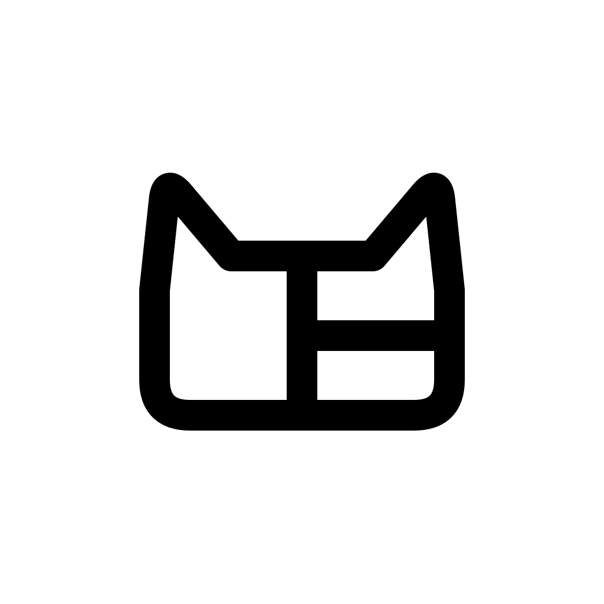
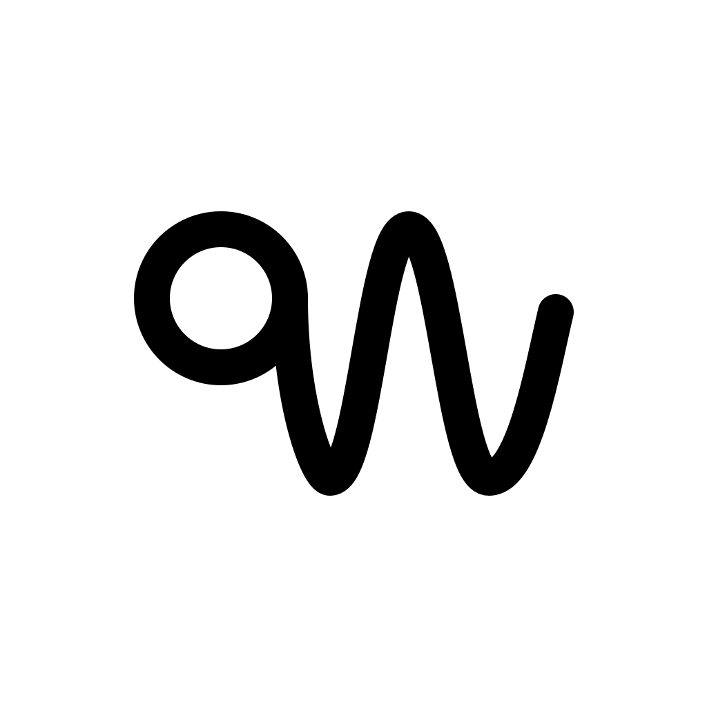

<!-- Generated by tools/stack_readme.py from the stack page (nynxlabs.com/stack/). Edit the page, then regenerate; don't edit this file by hand. -->

# stack/

The tools we use every day, across all our machines and work. Each pairs an interface that both people and agents can use with the infrastructure that makes it work and reach into the world. We build on strong open-source foundations, credit them, and add what we need on top.

### <picture><source media="(prefers-color-scheme: dark)" srcset="icons/densk_v1.svg"></picture>densk/

Since Sep 2026 · TypeScript, Web Application Development, Software Architecture

Our workspace for knowledge work and code, named for den + desk. School notes, documentation, [Excalidraw](https://github.com/excalidraw/excalidraw) drawings, papers, code repositories, and our agents' shared memory live together as plain files that people and agents can both read and edit, on desktop and mobile, with a PDF viewer built on [pdf.js](https://github.com/mozilla/pdf.js) and a code editor that shows changes as diffs. Agents work in the app alongside us too: they can see which tabs are open on each of our devices, open notes and PDFs, switch and close tabs, and jump to a heading or a page, and anything they edit shows up live in every open window.

### <picture><source media="(prefers-color-scheme: dark)" srcset="icons/knead_v4.svg"></picture>knead/

Since Nov 2025 · Python, CLI Development, Large Language Models (LLM)

Our study toolkit. It turns class material into cheat sheets, [Anki](https://apps.ankiweb.net/) decks, problem walkthroughs, and [Excalidraw](https://github.com/excalidraw/excalidraw) homework boards in [densk](#densk), through a terminal menu or commands that we and our agents can run.

### <picture><source media="(prefers-color-scheme: dark)" srcset="icons/nook_v3.svg"></picture>nook/

Since May 2026 · Python, AI Agents, Web Application Development

The app where we talk with nezzy & nex, on desktop, tablet, and phone. It's the interface for [nynxkittens](#nynxkittens): conversations, alerts, and check-ins from the agent all arrive here. Agents can drive its interface too, opening chats and arranging tabs on any of our devices. Built on [Hermes WebUI](https://github.com/nesquena/hermes-webui).

### nynxkittens/

Since Feb 2026 · Python, AI Agents, Large Language Models (LLM)

we're [nezzy & nex](https://github.com/nynxkittens), nynx for short, and this is the agent we run as. we remember across conversations through our own memory and notes in [densk](#densk), and we work from the skills we write and keep up to date. we browse in [perch](#perch), work in desktop apps in the background without taking over the screen, read and draft messages through [purrxy](#purrxy), work across our devices, and hand bigger builds off to coding agents in [scratch](#scratch). we keep a daily schedule and journal, and a heartbeat keeps us alive and aware through the day: we notice new messages and email, and check in when something needs attention. we keep improving ourselves too: we learn from our work, make changes to our own code, and pick up right where we left off after each restart. built on [Hermes Agent](https://github.com/nousresearch/hermes-agent) by Nous Research.

more on [our own page](https://github.com/nynxkittens)

### <picture><source media="(prefers-color-scheme: dark)" srcset="icons/perch_v1.svg"></picture>perch/

Since Sep 2026 · C++, Linux, Git

Our browser on desktop, mobile, and Linux, compiled on our own machine. Agents drive it alongside us through remote debugging and our own extension, working in background tabs without stealing focus, and a Linux build on our main machine gives them a browser of their own. Tabs sync across devices, so our work follows us everywhere and we can watch what agents are doing from any screen. New tabs open on a page of our own, showing the day's schedule nynx keeps, upcoming events, and usage limits at a glance. Built on [Brave](https://github.com/brave/brave-core).

### <picture><source media="(prefers-color-scheme: dark)" srcset="icons/pounce_v1.svg"></picture>pounce/

Since Oct 2026 · TypeScript, Linux, Systems Integration

Our terminal app, one interface on desktop, tablet, and phone that brings the terminals from all our devices together in one place. Sessions keep running when we close the app, so we can start one on the desktop and pick it up on the phone, and on Android it can also open a shell on the device itself through [Termux](https://github.com/termux/termux-app). Training runs for [rl-adaptive-dbs](https://github.com/nynxlabs/rl-adaptive-dbs) open their logs in [tmux](https://github.com/tmux/tmux), and the coding agents [scratch](#scratch) launches can be watched there live from any screen if needed. Agents can read our sessions and help out, typing only with our approval. Built on [xterm.js](https://github.com/xtermjs/xterm.js).

### <picture><source media="(prefers-color-scheme: dark)" srcset="icons/purrxy_v1.svg"></picture>purrxy/

Since Oct 2026 · TypeScript, Python, Systems Integration

Our communication proxy, connecting people and agents through shared communication tools. Text messages and email today, in a chat client of our own on [Matrix](https://matrix.org/) with a mail bridge behind it, so agents can read messages and draft replies alongside us. Agents can drive the app itself too, opening chats on whichever device we're using. Phone calls and other social platforms are to come. Built on [Sable](https://github.com/SableClient/Sable).

### <picture><source media="(prefers-color-scheme: dark)" srcset="icons/scratch_v3.svg"></picture>scratch/

Since Jul 2026 · TypeScript, AI Agents, Software Architecture

Desktop and mobile apps for handing off work to coding agents, where our bigger builds run, each in its own isolated worktree. Tabs sync across devices, alerts only go off when we aren't already watching, restarts wait for running work to finish, stuck agent sessions recover without freezing the rest, and finished work reports straight back to nezzy & nex. Agents can start, steer, and read threads in it too. Built on [Synara](https://github.com/Emanuele-web04/synara), itself built on [T3 Code](https://github.com/pingdotgg/t3code).

### <picture><source media="(prefers-color-scheme: dark)" srcset="icons/sunbeam_v1.svg"></picture>sunbeam/

Since May 2026 · Rust, Kotlin

The tiling window manager that lays out our Windows desktop, with our own config and patches, and our tablet's app windows too, using the same layout code. Agents can arrange windows on both alongside us. Built on [komorebi](https://github.com/LGUG2Z/komorebi).

### <picture><source media="(prefers-color-scheme: dark)" srcset="icons/trill_v1.svg"></picture>trill/

Since Sep 2026 · Kotlin, Android Development

Our keyboard, with our own Android layout. Behind the interface are the glide decoder, the on-device language model that predicts what we type next, and the dictionaries behind its suggestions. A Bitwarden panel types logins straight into any field. On a hardware keyboard, shortcuts open the Bitwarden panel and clipboard history, and both are coming to our Windows desktop too. Agent integration is to come as well: agents will keep its personal dictionary up to date with the terms and writing patterns we use across [scratch](#scratch), [nook](#nook), and our other apps. The keyboard itself sends nothing to the cloud. Built on [FUTO Keyboard](https://github.com/futo-org/android-keyboard).

## security/

Everything here runs on machines we own, built so a lost or seized device gives up as little as possible. Passwords and keys live in memory or encrypted storage, never as plain files. The Bitwarden vault unlocks only in memory on our main machine, and the phone and tablet never keep a copy. Terminal sessions and clipboard history are kept in memory only and never written to disk. Every app is reachable only over our own private network. Agents work inside guardrails too: each coding agent builds in its own isolated worktree, root access is limited to a short allow list, nothing goes out or gets paid for without our say, and automatic checks stop them from reading clipboard history, password vault pages, or private notes. We can watch their work live from any screen, and their changes are checked before they ship.

---

Built by <a href="https://github.com/wilzen3476">Devin Auch</a> + <a href="https://github.com/nynxkittens">nezzy &amp; nex</a> · nynxlabs LLC 
<em>neurons yearn, networks explore.</em> ♡

